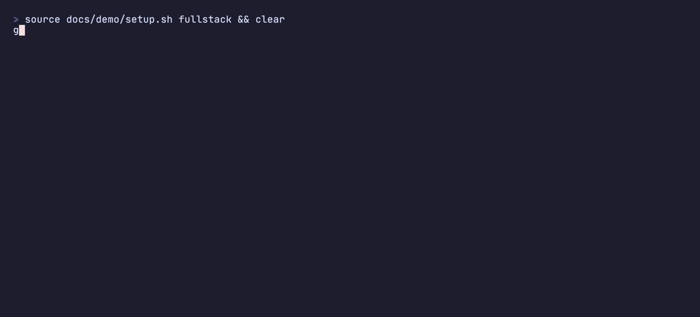

<p align="center">
  
</p>

# gsttt

It answers one question without guessing: what does this change affect?

[Website](https://gsttt.arstoien.com) · [Releases](https://github.com/SkuratovichA/gsttt/releases) · [Claude Code plugin](plugin/README.md)

gsttt builds a graph of the files in a repository and of the contracts between them: imports, HTTP routes and the calls that reach them, GraphQL, gRPC and tRPC operations, database tables and environment variables. It follows them across packages, languages and services. No model runs anywhere in it, so the same tree always gives the same answer, and every answer says how much of the repository it covers and how fresh the index is.

<p align="center">
  
</p>

## Install

```sh
curl -fsSL https://raw.githubusercontent.com/SkuratovichA/gsttt/main/install.sh | sh
```

The installer checks the SHA-256 of what it downloads and puts `gsttt` in `~/.local/bin`, or in `GSTTT_INSTALL_DIR` when that is set. Linux and macOS, on x86-64 and arm64.

Without the installer, each release is also a container image on ghcr.io, for CI pipelines and for MCP clients that start their servers through `docker run`:

```sh
docker run --rm --user "$(id -u):$(id -g)" -v "$PWD:/repo" ghcr.io/skuratovicha/gsttt impact --changed
docker run --rm -i --user "$(id -u):$(id -g)" -v "$PWD:/repo" ghcr.io/skuratovicha/gsttt mcp   # the MCP server, over standard input and output
```

`--user` is there because the index is written to `.git/gsttt` of the repository, which would otherwise belong to root.

Then, in a repository:

```sh
gsttt impact --changed    # what the changes since HEAD affect
gsttt impact src/api.ts   # what a change to one file would affect
gsttt coverage            # what gsttt read, and what it cannot see in this repository
```

The first answer builds the index, and every later one rereads only the files that changed. `gsttt --help` lists the other questions: `dependents`, `dependencies`, `path` and `contract`.

To give Claude Code the same answers, add the plugin from this repository:

```text
/plugin marketplace add SkuratovichA/gsttt
/plugin install gsttt@gsttt
```

It brings the gsttt MCP server and a skill that says when to ask it; [plugin/README.md](plugin/README.md) has the details.

## Speed

<p align="center">
  
</p>

## What it reads

- Languages: TypeScript and JavaScript, Python, Rust.
- Contracts: OpenAPI, GraphQL, protobuf, Prisma, SQL, `.env` files.
- Framework knowledge lives in TOML rule packs, and any other language can join as an external connector that speaks JSON lines.
- Configuration is TOML, in `.gsttt/config.toml`, with a JSON Schema that checks it in the editor; `gsttt init` writes both.

## Known gaps

`gsttt coverage` prints every connector gap below that applies to your repository, so an answer never hides one. The ones marked *not reported* are those it cannot print.

- **Linux and macOS only.** Windows is neither built nor tested.
- **A framework is read only where a manifest declares it.** A project's routes, clients and tables are read by the rules of the frameworks its `package.json`, `pyproject.toml`, `setup.py`, `setup.cfg`, requirements files or `Cargo.toml` list as dependencies; a framework that is installed some other way, such as by a Dockerfile, is not read, and its imports show up in `gsttt coverage` as a package that is in no manifest.
- **Nothing computed at run time is followed:** URLs, route prefixes, table names, SQL and environment variable names held in variables or built from strings, and dependency-injection containers. Code, routes and schemas generated at build time are not read either.

<details>
<summary>TypeScript and JavaScript</summary>

- Routes defined by the file system (Next.js, Remix, SvelteKit).
- A global prefix set at start-up with NestJS `setGlobalPrefix`.
- Routers mounted from another package, and routes on an app or router received as a function parameter: the app or router must be made in the file that declares the routes.
- A mount path array is read for its literal elements only, and routers that mount each other in a cycle are followed until the cycle closes.
- An `axios.create` client made in another file than the one that calls it.
- GraphQL resolvers built at run time, and schema-first resolvers outside a resolvers map.
- tRPC routers merged or built at run time, router entries that are spread, read from a member (`other.router`) or built by another call, and clients named anything other than `trpc` or `api`.
- Raw SQL and query builders, and Prisma clients under a root other than the chain roots of the `prisma` pack, unless the file reaches the client through an alias of `this` or declares the name with one of the root types of the pack, directly or through a `type` alias of the same file.
- A Prisma root type that a file imports under another name (`PrismaClient as Base`), reaches through a renamed namespace (`P.TransactionClient`), writes as `typeof` a name, or aliases as an import type (`type Db = import('@prisma/client').PrismaClient`).
- The model types of a Prisma client generated to a custom `output` path, or of a package that re-exports the client with `export * from '@prisma/client'`: only the imports from `@prisma/client` itself name a table.
- An enum imported by name from `@prisma/client` reads as a table of that name that no model declares, because the import does not say which names are models.
- Environment variables read through an alias of the environment object.

</details>

<details>
<summary>Python</summary>

- GraphQL servers (Strawberry, Graphene) and task queues (Celery, RQ, Dramatiq).
- FastAPI routers and Flask blueprints created in another module than the one that declares their routes.
- Router mounts made from another Python project, in a cycle, deeper than 32 routers or in more than 64 ways, through an import that cannot be resolved, or through a name re-exported by a module other than a package's `__init__.py`.
- FastAPI applications mounted under a path with `mount`, as Starlette does, and routes added with `add_api_route`.
- Flask routes with several methods are read for the first one only, methods held in a variable are read as GET, and `add_url_rule` and class-based views are not read.
- Django `re_path` and regex routes, Django REST framework routers, and Django's default table names.
- HTTP clients other than requests and httpx, sessions and clients created in another module than the one that uses them, and a client library imported under one name in both `try` and `except`, of which the last import is read.
- Names brought in by a star import are not matched to the module they come from.
- SQLAlchemy table names given by `declared_attr` or inherited from a mixin, and DB-API `execute` calls on a receiver of more than three segments.
- Settings read by environs, django-environ or python-decouple, fields of a settings class that derives from another settings class, and an alias written inside a field's annotation.

</details>

<details>
<summary>Rust</summary>

- Names that a glob import brings in, such as `prop` after `use proptest::prelude::*`: a path that starts with one is reported as an unknown package.
- Paths inside `macro_rules!` bodies, items generated by macros, and code included with `include!` from generated files.
- A crate target with more than 10000 modules is read up to that many.
- A module declared twice under different `cfg`s, such as `unix.rs` and `win.rs` behind one `mod sys;`: every path that names it reaches the first file, and none reaches the other.
- actix `configure`: the routes a function registers on a `ServiceConfig` keep the path they are written with.
- Routers built in another crate, re-exported with `pub use`, kept in a field, passed as an argument, returned from a branch or mounted with `nest_service` are not placed under the prefix they are mounted at, and neither are routers built by an associated function (`Type::router()`), nested more than 64 deep, or entered more than 50000 times in one walk.
- A request through a client returned by another function or hidden behind a type alias, and a URL with no literal path.
- tonic gRPC services, Diesel `table!`, and queries written with the Diesel or SeaORM builders.
- *Not reported:* axum 0.7 wildcard paths such as `/*rest`; facade crates such as `shuttle-axum`, because a framework's rules apply only to a dependency the manifest declares itself; a dependency renamed to a framework's name, such as `axum = { package = "my-router" }`, switches that framework's rules on; dev-dependencies are visible to non-test code; the functions a router reaches are matched by name within a file.

</details>

<details>
<summary>Contracts</summary>

- OpenAPI path items that refer to another place in the same document.
- GraphQL root types renamed by a `schema` definition in another file, `# import` lines, and fragments spread from other files.
- protobuf HTTP rules written in a gRPC service config file.
- Prisma environment variables read outside the `datasource` block.
- SQL tables created by ORM migrations written in code or inside stored procedures, statements the SQL parser does not read, and tables named like a common table expression or a table function elsewhere in the same statement.
- Environment variables set in compose files, CI and deployment manifests.
- A document embedded in code in a language no connector reads.
- *Not reported:* MySQL's `RENAME TABLE a TO b` declares nothing (`ALTER TABLE a RENAME TO b` does), and a gateway prefix with a parameter, such as `/api/{version}`, is taken off only paths that hold a parameter in that place, not `/api/v1/…`.

</details>

<details>
<summary>Indexing and trust (not reported)</summary>

- When git filters a file on checkout (`core.autocrlf`, a `.gitattributes` filter), its facts are keyed by the blob in the git index but read from the bytes in the work tree.
- A save between the listing and the read that keeps both the file's size and its modification time leaves the new facts under the old bytes until the next run.
- A crash between writing the index and renaming it into place leaves a temporary file behind, and so does a crash while `gsttt config trust` writes (`trust.*.tmp` in the state directory).
- The trust key of an external connector covers the files its command line names, not the modules a script imports or the files a binary reads, and not the target of a link inside the repository that points outside it, so a pull that changes only those runs the connector without a new prompt.

</details>

## License

Apache-2.0.
